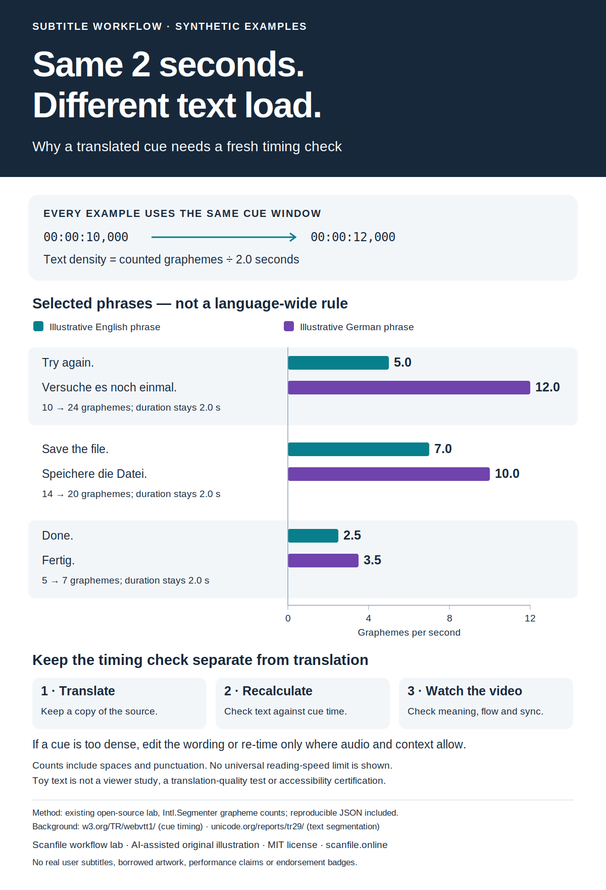

# Same two seconds, different text load

This teaching graphic explains a small but useful distinction: changing subtitle text does not automatically change the interval in which a viewer sees it. Three deliberately selected English/German phrase pairs share a two-second cue. The chart shows the exact grapheme counts and the arithmetic density for each phrase. It is an illustration, not a representative sample of either language, a human-participant experiment, a translation benchmark or a claim about typical language expansion. Its colors distinguish the two sets of phrases; they do not mean “safe” and “unsafe.”

The workflow is to keep the source, translate, recalculate text density, and watch the result with the actual video. A count alone cannot judge a translation's meaning, an audience's reading ability, the audio relationship, or accessibility compliance. There is no universal reading-speed threshold in this graphic. Any wording or timing change needs review in its actual context.

Spaces and punctuation count. For these precomposed Latin examples, Unicode code-point counts and grapheme-cluster counts agree. The underlying lab also demonstrates cases where they differ, including combining characters and joined emoji. These illustrative German phrases are not represented as professionally reviewed translations.

## Reproduce and inspect

- `generate.cjs` creates `measurements.json` and the editable `infographic.svg` using the existing lab's counting logic.
- Run `node infographics/cue-text-load/generate.cjs` from the repository root with Node.js 20 or later and `Intl.Segmenter` available.
- `infographic.png` is an offline CairoSVG 2.8.2 rendering of the original SVG at 1200 × 1760 pixels, included for convenient viewing and editorial reproduction. To regenerate it with that optional renderer: `cairosvg infographic.svg -o infographic.png` from this directory.
- The measured data and source are included so readers can check each value. No external data service or user files are used.

Background references: [W3C WebVTT cue model](https://www.w3.org/TR/webvtt1/#webvtt-cues) and [Unicode text segmentation, UAX #29](https://www.unicode.org/reports/tr29/). WebVTT is cited for its general cue time/text model; this does not claim that this repository's small SRT parser implements the full WebVTT specification or that its runtime implements the latest Unicode release.

## Rights, provenance and affiliation

The chart, toy examples, generator, prose and visual layout are original AI-assisted educational material from the Scanfile workflow lab, released under the repository's MIT license. Substantial generative AI assistance was used to draft the graphic, code, phrases and explanation. Automated checks and an AI visual inspection are documented in the associated operations evidence; no independent human review or participant research is claimed. No third-party illustration, customer subtitle file, product screenshot or font binary is bundled.

The project is affiliated with [Scanfile](https://scanfile.online/), a commercial browser-based file translator with conditional sample/preview options and paid one-time credits. This freely reusable teaching material does not make the hosted translation service open source, free without limits, or endorsed by the reference organizations. This new graphic is separate from the previously archived software files, which remain unchanged.
